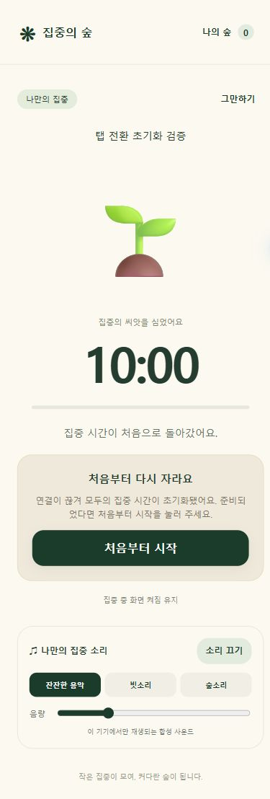

# 검증 기록 — 2026-10-17

대상: https://focus-forest-hackathon.yoon2566.workers.dev

## 자동 검증

- 상태 엔진 13개 테스트 통과 (`npm test`)
- 공개 서버 4개 독립 WebSocket 연결: 입장·인원 제한·방장 시작·전원 준비 확인
- 다섯 번째 입장 및 시작 후 입장 거절
- 한 명의 이탈 메시지 후 모든 참가자의 누적 시간 0 확인
- 여러 명 이탈 시 모두 명시적으로 복귀해야 다시 시작
- 연결 종료·재접속 후 자동 재개 방지
- 도전 종료 시 전원 종료, 포인트 0
- 실제 60초 동안 하트비트를 유지하여 서버 완료 판정 및 2P 지급 확인
- 클라이언트 JavaScript 문법 검사

재현:

```powershell
cd web
npm test
node tests/integration.mjs https://focus-forest-hackathon.yoon2566.workers.dev --complete
```

테스트 방은 TEST 닉네임을 사용하며 별도 생성됩니다. 2시간 후 삭제됩니다.

## 브라우저 확인

- 데스크톱 브라우저 2개에서 초대코드 입장, 참여자 동기화, 모두 준비 후 공동 타이머 시작
- 390×844 모바일 뷰포트에서 화면 표시 확인 (휴대폰 실기기 검증과 구분)
- 브라우저 화면에 화면 켜짐 유지 성공 상태 표시 확인
- 1분 체험의 실제 완료 화면, 포인트, 숲 기록, 일반 집중 통계에서 체험 제외 확인

- 최신 버전 Chrome에서 실제 탭 전환 확인: 10분 도전의 09:50 시점에 브라우저 포커스 에뮬레이션을 해제하고 다른 탭으로 전환 → 10:00으로 초기화, 처음부터 시작 버튼 표시. 이후 에뮬레이션 원복
- 처음부터 시작 버튼으로 09:56까지 다시 진행 확인
- 합성 음악 켜기/끄기 상태 및 종료 확인창의 계속 집중하기/도전 종료하기 확인
- 공개 정적 파일 4개(index.html, app.js, style.css, tree.svg) HTTP 200 및 로컬 SHA-256 일치
- GitHub Actions 웹 문법·13개 테스트·Worker dry-run 빌드 성공: https://github.com/yoon2566/youtube-focus-guard/actions/runs/39029695872



## 미검증

- Android 실기기의 화면 잠금, 절전·백그라운드 제한, 다양한 제조사 브라우저
- 대규모 부하·공격 대응 및 장기간 운영
- 합성 음원의 실제 스피커 출력 청음

개발 중 기존 방은 이전 Worker 인스턴스를 사용할 수 있으므로 최종 규칙 검증은 새 방에서 진행합니다.
